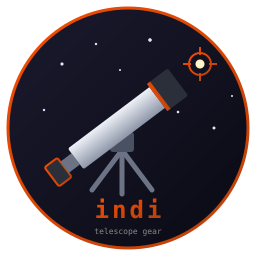
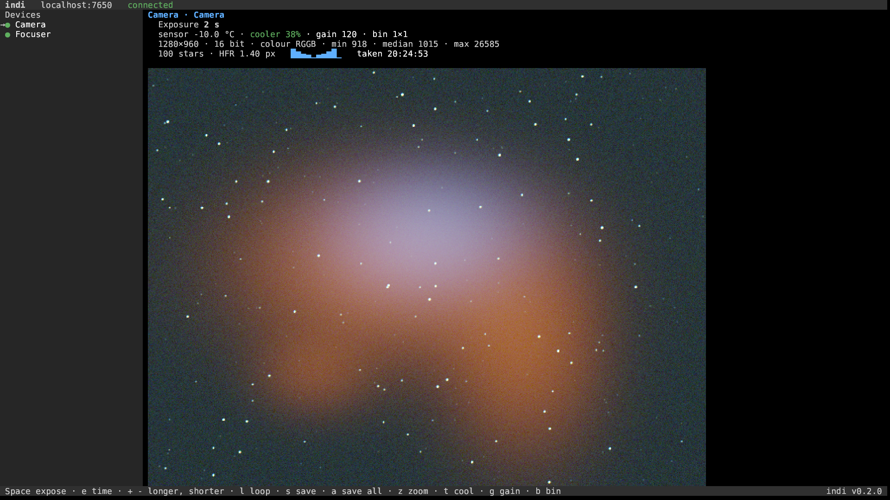
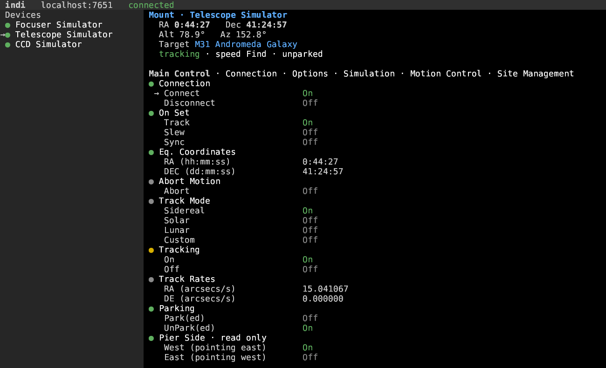
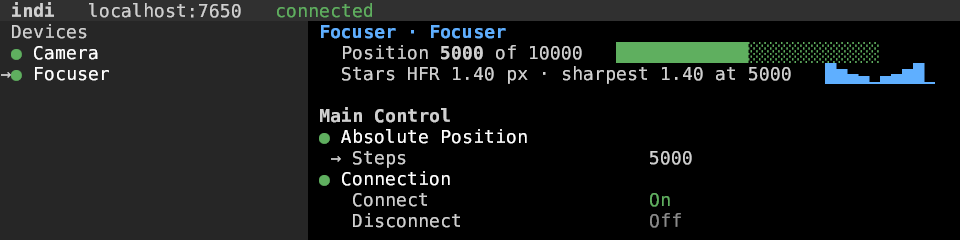
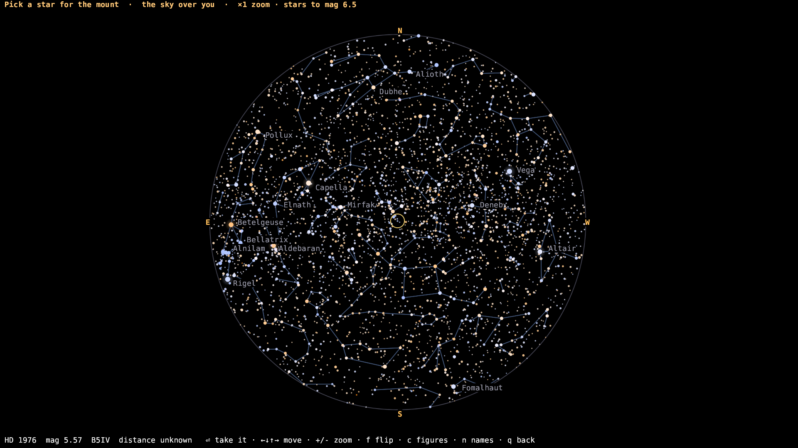

# indi



**Telescope gear in the terminal. Written in Rust.**

   

indi talks to an [INDI](https://indilib.org) server, the program that
drives focusers, mounts, cameras and filter wheels, and shows every
device it has.



- **Devices**: every device the server has, with a green dot when it is
  connected. All its settings show in the groups its driver defines, each
  with a dot: grey idle, green fine, yellow busy, red trouble.
- **Focuser**: moves of 1, 10 or 100 steps, a go-to, and nine saved
  positions with names. It shows the sharpest HFR so far and where it
  was taken, so focusing means making one number small.
- **Mount**: where it points, how high, and whether it tracks. Hold an
  arrow to move it. It goes to a planet, the Moon, a Messier or Caldwell
  object, a named star, or a star you pick on a map of tonight's sky.
  It asks first below the horizon or near the Sun, and never points at
  the Sun.
- **Camera**: exposure, cooling, gain and binning. Each picture shows in
  real pixels where the terminal shows images, half blocks elsewhere.
  It is stretched so the faint sky shows, and in colour from a colour
  sensor. indi counts the stars and measures how sharp they are (HFR).
  It takes pictures over and over, zooms to pixel size and saves FITS.
- **Drivers**: tick them in a list and indi starts the server, and again
  next time. It also reaches a server on another machine, such as a
  Raspberry Pi at the telescope.
- **Night colours**: red on black, to keep your eyes used to the dark.
- **Claude**: Ctrl+A opens a session about the device on screen.
- **Idle**: with no key and no news from the gear, indi does no work.

indi is built on [crust](https://github.com/isene/crust), the terminal
library of the [Fe₂O₃](https://github.com/isene/fe2o3) suite. It
replaces the Ruby `tuindi` in
[ruby-indi](https://github.com/isene/ruby-indi).







The pictures come from a test camera with a made-up nebula and the
INDI simulators.

## Start

Run `indi`. With no server running, press `d`, tick the drivers for your
gear and press Enter: indi starts the server and connects. It remembers
the drivers and starts them again next time. A server indi started
ends when indi does.

Or start the server yourself. For a ZWO EAF focuser and an EQMod mount
(an EQ6-R Pro, say):

```bash
indiserver indi_ieaf_focuser indi_eqmod_telescope
indi
```

To try it without gear, use the simulators:

```bash
indiserver indi_simulator_telescope indi_simulator_focus indi_simulator_ccd
```

`indi host` or `indi host:port` reaches a server on another machine,
for example a Raspberry Pi at the telescope. The port is 7624 when left
out. On Debian and Ubuntu the server and the drivers come in the
package `indi-bin`.

## Keys

| Key | What it does |
|---|---|
| Tab | Moves between the devices, the control block and the settings |
| ↑ ↓ | Picks a device or a setting |
| ← → | Shows the next or the last group of settings |
| Enter | Connects a device, flips a switch, or asks for a new value |
| + - | Nudges a number setting by its step |
| / | Finds a setting by name |
| c | Connects or disconnects the device |
| W | Has the driver save the device's settings |
| d | Picks drivers and starts a server |
| m | Shows the messages from the server, errors in red |
| n | Switches the night colours on or off |
| r | Connects to the server again |
| Ctrl+A | Asks Claude about the device on screen |
| ? | Shows the help |
| q | Quits; a mount that is moving is stopped first |

In the focuser's control block:

| Key | What it does |
|---|---|
| ← → | Moves 10 steps in or out |
| Shift+← → | Moves 100 steps |
| [ ] | Moves 1 step |
| g | Goes to a position you type |
| s | Saves the position in a slot from 1 to 9, with a name |
| 1 to 9 | Goes back to a saved position |
| Space | Stops the focuser |

In the mount's control block:

| Key | What it does |
|---|---|
| ↑ ↓ ← → | Moves north, south, east or west while you hold the key |
| Space | Stops all motion |
| g | Goes to a name (`M42`, `Vega`, `Jupiter`) or an RA and Dec (`5:35:17 -5:23:28`) |
| s | Picks a star on a map of the sky and goes there |
| y | Syncs: tells the mount it points at the name you type |
| + - | Changes the speed |
| t | Turns tracking on or off |
| p | Parks or unparks the mount, after a yes |

The mount stops when you let go of an arrow in terminals that report
key releases, such as kitty. In other terminals it moves until you
press Space.

In the camera's control block:

| Key | What it does |
|---|---|
| Space | Takes a picture, or stops the one being taken |
| e | Sets the exposure time in seconds |
| + - | Doubles or halves the exposure time |
| l | Takes pictures over and over; l again stops after this one |
| z | Shows the middle of the picture pixel for pixel, for focusing |
| s | Saves the picture as the FITS file the camera sent |
| a | Saves every picture as it comes |
| t | Cools the sensor to a temperature you type |
| g | Sets the gain |
| b | Steps the binning: 1×1, 2×2 and so on |

Pictures are saved in `~/Pictures/indi`, named by the mount's target (or
the camera) and the time: `M42_Orion_Nebula_2026-11-18T21-30-05.fits`.
indi reads FITS pictures; a camera set to compress them shows a note
instead.

## Settings

indi keeps its settings in `~/.indirc` and rewrites the file when you
change one in the app:

```
night = no
lat = 51.48
lon = 0.0
drivers = indi_ieaf_focuser indi_eqmod_telescope
focus1 = 31250 Visual
focus2 = 30120 Camera
exposure = 2
pictures = ~/Pictures/indi
```

`lat` and `lon` (east is positive) are used only when the mount does
not know where it stands. With a site, indi shows how high the mount
points and warns before a go-to below the horizon.

## Install

Download a binary from the
[releases](https://github.com/isene/indi/releases) (Linux on Intel or
ARM, macOS), or build it beside the libraries it uses:

```bash
for r in crust glow orbit starmap indi; do git clone https://github.com/isene/$r; done
cd indi && cargo build --release
```

## Cost while it waits

A thread reads the server and wakes the program only when something
changes. With no key and no news from the gear, indi does no work.

The server sends a camera's pictures only after the first exposure from
indi, and a picture is drawn again only when it, its place or its
colours change. A 26-megapixel picture takes about a fifth of a second
to read, measure and draw.

## License

[Unlicense](https://unlicense.org): public domain.
